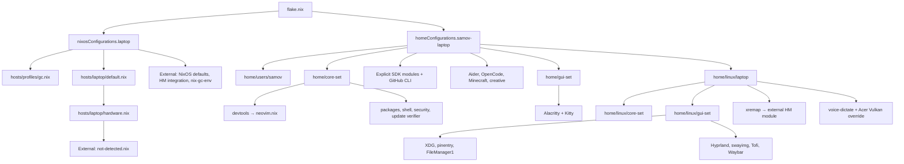

# Карта подключённых модулей Acer

[Обзор и границы](README.md) · [Компоненты](components.md)

Карта исходного среза `a2d1767`: после ревью imports Aider закомментированы
на laptop/desktop, поэтому локальных HM module files для Acer стало 37, а не 38.
Остальные изменения/решения — в [журнале ревью](feedback.md). Таблица ниже сохраняет
исходный состав, не является свежей оценкой установленного профиля.

Отдельным структурным шагом `git-filter-repo` вынесен в
`home/core-set/devtools/git-maintenance.nix`, подключённый явно рядом с
`nix-authoring.nix` на laptop/desktop/mac. Теперь для Acer снова 38 локальных HM
module files, **без добавления пакетов**; server новый module не импортирует.

## Два независимых слоя

Это схема групп, не граф каждого пакета. HM, импортированный через `mkNixos`, не
означает, что `samov-laptop` активируется вместе с системой: пользовательская
конфигурация здесь собирается отдельным `mkHM`.

## Локальные NixOS-модули: 3

| Модуль                                                       | Кто подключает               | Назначение / граница                                                     |
| ------------------------------------------------------------ | ---------------------------- | ------------------------------------------------------------------------ |
| [hosts/profiles/gc.nix](../../hosts/profiles/gc.nix)         | `flake.nix → mkNixos`        | Очистка HM/user profiles перед store GC, `nix-gc-run`                    |
| [hosts/laptop/default.nix](../../hosts/laptop/default.nix)   | `flake.nix → laptop.modules` | Пока монолит: оборудование, сеть, desktop, учётная запись и обслуживание |
| [hosts/laptop/hardware.nix](../../hosts/laptop/hardware.nix) | `hosts/laptop/default.nix`   | Storage/initrd, CPU microcode и platform; аппаратные данные Acer         |

Внешние module imports: `home-manager.nixosModules.home-manager`,
`nix-gc-env.nixosModules.default` через `mkNixos`,
`modulesPath + /installer/scan/not-detected.nix` через hardware; далее upstream
NixOS imports. Inline overlay module в `mkNixos` не отдельный локальный файл.
**Disko в текущий Acer не импортирован.**

## Локальные HM-модули: 38

Все пути ниже относительны корню репозитория; каталог в import означает его
`default.nix`. «Flake» — непосредственно `samov-laptop.modules`, а не неявное
подключение всех файлов соседнего каталога.

|   № | Модуль                                                                                                         | Непосредственный родитель | Роль                                                               |
| --: | -------------------------------------------------------------------------------------------------------------- | ------------------------- | ------------------------------------------------------------------ |
|   1 | [home/users/samov/default.nix](../../home/users/samov/default.nix)                                             | Flake                     | Home identity, legacy stateVersion, HM CLI                         |
|   2 | [home/core-set/default.nix](../../home/core-set/default.nix)                                                   | Flake                     | Core imports + rclone                                              |
|   3 | [home/core-set/devtools/default.nix](../../home/core-set/devtools/default.nix)                                 | Core                      | Импорт Neovim                                                      |
|   4 | [home/core-set/devtools/neovim.nix](../../home/core-set/devtools/neovim.nix)                                   | Devtools                  | Только Neovim package, EDITOR и aliases                            |
|   5 | [home/core-set/nix-flake-update-verify.nix](../../home/core-set/nix-flake-update-verify.nix)                   | Core                      | Явный update/build helper                                          |
|   6 | [home/core-set/packages.nix](../../home/core-set/packages.nix)                                                 | Core                      | ripgrep, fd, unzip, socat                                          |
|   7 | [home/core-set/security.nix](../../home/core-set/security.nix)                                                 | Core                      | GPG, agent, pass                                                   |
|   8 | [home/core-set/shell.nix](../../home/core-set/shell.nix)                                                       | Core                      | Fish, fzf, Atuin, zoxide, Yazi, direnv                             |
|   9 | [home/core-set/nix-authoring.nix](../../home/core-set/nix-authoring.nix)                                       | Flake                     | nixfmt, nixd, git-filter-repo                                      |
|  10 | [home/core-set/go.nix](../../home/core-set/go.nix)                                                             | Flake                     | Go                                                                 |
|  11 | [home/core-set/node.nix](../../home/core-set/node.nix)                                                         | Flake                     | Node.js                                                            |
|  12 | [home/core-set/python.nix](../../home/core-set/python.nix)                                                     | Flake                     | Python                                                             |
|  13 | [home/core-set/devenv.nix](../../home/core-set/devenv.nix)                                                     | Flake                     | devenv                                                             |
|  14 | [home/core-set/native-build.nix](../../home/core-set/native-build.nix)                                         | Flake                     | GCC, Make                                                          |
|  15 | [home/core-set/treesitter.nix](../../home/core-set/treesitter.nix)                                             | Flake                     | Tree-sitter CLI                                                    |
|  16 | [home/core-set/devtools/github.nix](../../home/core-set/devtools/github.nix)                                   | Flake                     | GitHub CLI                                                         |
|  17 | [home/apps/aider/default.nix](../../home/apps/aider/default.nix)                                               | Flake                     | Aider full                                                         |
|  18 | [home/apps/opencode/default.nix](../../home/apps/opencode/default.nix)                                         | Flake                     | Pinned OpenCode, config/plugins/helpers                            |
|  19 | [home/apps/opencode/decision-support.nix](../../home/apps/opencode/decision-support.nix)                       | OpenCode                  | Явный opt-in notes/decision support; включён домашним default      |
|  20 | [home/gui-set/default.nix](../../home/gui-set/default.nix)                                                     | Flake                     | Терминалы, Firefox, Chrome, MPV, ueberzugpp                        |
|  21 | [home/modules/alacritty/default.nix](../../home/modules/alacritty/default.nix)                                 | GUI                       | Alacritty, темы и preview helper                                   |
|  22 | [home/modules/kitty/default.nix](../../home/modules/kitty/default.nix)                                         | GUI                       | Kitty, шрифт, generated langmap-aware config                       |
|  23 | [home/modules/minecraft/server/default.nix](../../home/modules/minecraft/server/default.nix)                   | Flake                     | Generic server implementation; без instance по умолчанию неактивен |
|  24 | [home/apps/minecraft/default.nix](../../home/apps/minecraft/default.nix)                                       | Flake                     | Launcher, Packwiz, JDK, instance и memory policy                   |
|  25 | [home/apps/creative.nix](../../home/apps/creative.nix)                                                         | Flake                     | Blender                                                            |
|  26 | [home/linux/laptop/default.nix](../../home/linux/laptop/default.nix)                                           | Flake                     | Linux imports, raw host configs, Vulkan device override            |
|  27 | [home/linux/core-set/default.nix](../../home/linux/core-set/default.nix)                                       | Laptop leaf               | Xray, Android tools, adbfs, btop                                   |
|  28 | [home/linux/gui-set/default.nix](../../home/linux/gui-set/default.nix)                                         | Laptop leaf               | Linux desktop imports/apps/services, Qt                            |
|  29 | [home/linux/gui-set/xdg.nix](../../home/linux/gui-set/xdg.nix)                                                 | Linux GUI                 | MIME defaults и Yazi desktop entry                                 |
|  30 | [home/linux/gui-set/security.nix](../../home/linux/gui-set/security.nix)                                       | Linux GUI                 | Qt pinentry для GPG agent                                          |
|  31 | [home/linux/modules/filemanager1-common/default.nix](../../home/linux/modules/filemanager1-common/default.nix) | Linux GUI                 | FileManager1 module, Yazi/Kitty integration                        |
|  32 | [home/linux/modules/hyprland/default.nix](../../home/linux/modules/hyprland/default.nix)                       | Linux GUI                 | Session integration, scripts, bell, local plugin                   |
|  33 | [home/linux/modules/swayimg/default.nix](../../home/linux/modules/swayimg/default.nix)                         | Linux GUI                 | Unstable swayimg и Yazi opener                                     |
|  34 | [home/linux/modules/tofi/default.nix](../../home/linux/modules/tofi/default.nix)                               | Linux GUI                 | Включение Tofi и menus                                             |
|  35 | [home/linux/modules/tofi/module.nix](../../home/linux/modules/tofi/module.nix)                                 | Tofi                      | Опции и реализации menu helpers                                    |
|  36 | [home/linux/modules/waybar/default.nix](../../home/linux/modules/waybar/default.nix)                           | Linux GUI                 | Waybar, CSS и scripts                                              |
|  37 | [home/linux/modules/xremap/default.nix](../../home/linux/modules/xremap/default.nix)                           | Laptop leaf               | Evdev remap; импорт внешнего xremap HM module                      |
|  38 | [home/modules/voice-dictate/default.nix](../../home/modules/voice-dictate/default.nix)                         | Laptop leaf               | Whisper wrapper, model и Vulkan options                            |

Число 38 сверено механическим обходом явных локальных `imports` от flake seeds
и чтением источников. Это не число всех upstream HM modules. Внешний импорт —
`xremap-flake.homeManagerModules.default`; стандартные HM modules подключает
`homeManagerConfiguration`.

## Источники пакетов и не-module файлы

- NixOS: stable nixpkgs + локальный overlay
  [Amnezia](../../pkgs/amnezia-vpn/default.nix).
- HM: stable nixpkgs + overlays
  [FileManager1](../../pkgs/filemanager1-common/default.nix) и Freesm.
- `pkgsUnstable` передаётся отдельно: Yazi/plugin и swayimg выбирают его явно;
  это не перевод всего профиля на unstable.
- Chrome поступает через `browser-previews`, OpenCode — отдельный pinned input.
- [hypr-spaces](../../pkgs/hypr-spaces/default.nix),
  [onionbell](../../pkgs/onionbell/default.nix) — `callPackage` из Hyprland module,
  а не новые module imports. Аналогично OpenCode `package.nix` — package expression.
- Raw `hyprland.conf` и `waybar-config.jsonc` подключает laptop leaf;
  Kitty генерирует config из upstream template и local fragments. Скрипты, Lua,
  patches, fonts и модели не добавляются к счётчику модулей.

## Не входит в этот Acer

Hermes отключён в flake; declarative `nvim-config` закомментирован;
`home/modules/profile-gc` в Acer HM не импортирован (его cleanup реализован на
стороне NixOS). Server/desktop/mac leaves, fresh-host state override,
Disko и OpenCode archives не следует считать активными только по наличию файлов.
