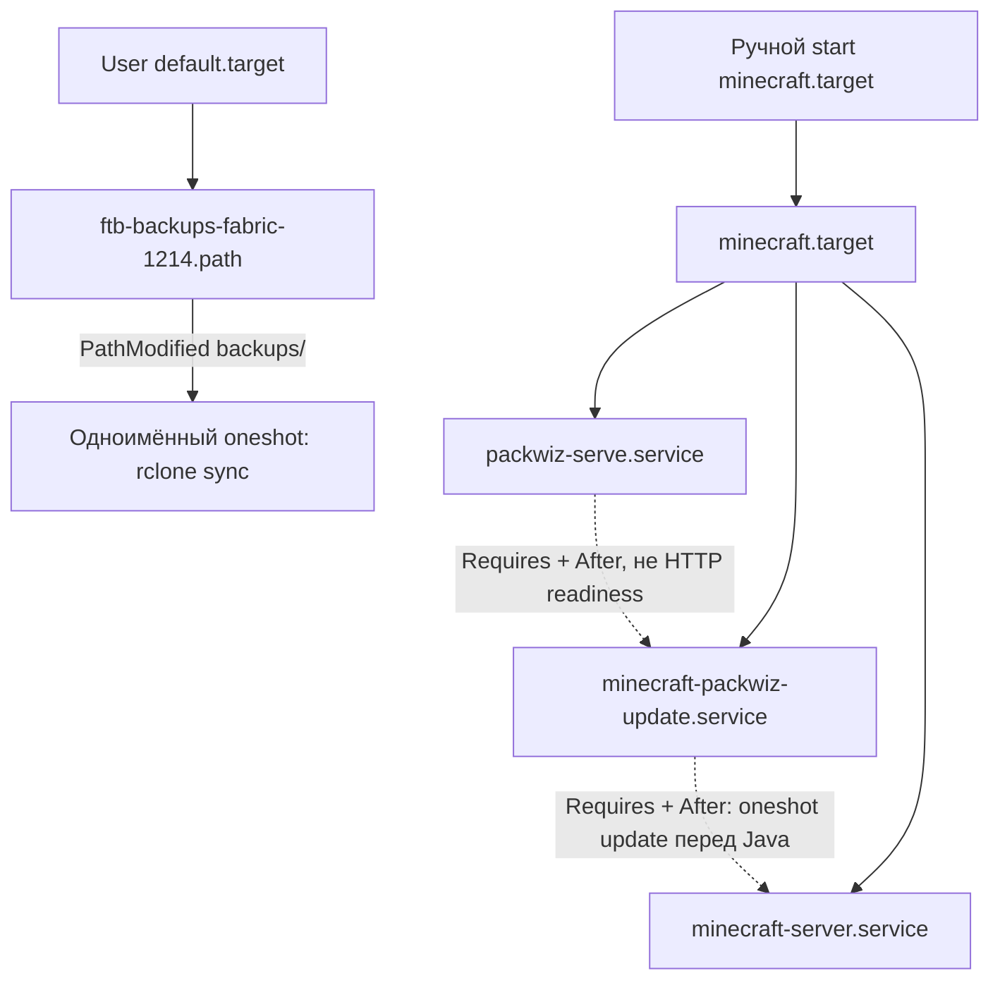
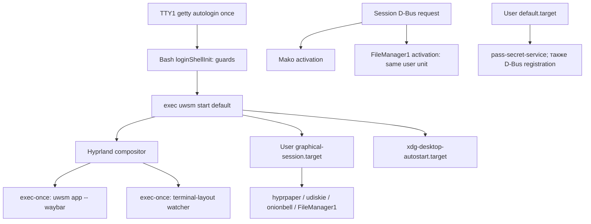

# Карта запуска: Minecraft, proxy и GUI

[Каталог](README.md) · [Решения и вопросы](feedback.md)

Source-first срез **08.11.2026**, конфигурация `086d82e`. Это описание объявленного
поведения, не доказательство работающих процессов. Службы, конфиги и ручное
состояние не менялись. Область: выбранные цепочки Acer; не полный startup/security audit.

## Как читать зависимости

- `WantedBy` задаёт подключение при enable/декларативной установке; не запускает
  произвольный target само по себе. `After` задаёт порядок, не готовность HTTP/сети.
- `Requires` подтягивает зависимость; `PartOf` распространяет stop/restart от
  указанной unit к зависимой. Это разные связи.
- User `default.target` относится к запуску пользовательского systemd manager,
  не обязательно к появлению GUI. Состояние lingering/ручных enable не обследовалось.

Семантика: [systemd.unit(5)](https://www.freedesktop.org/software/systemd/man/latest/systemd.unit.html).

## Minecraft: отдельный запуск и независимый backup watcher

Источники: [flake](../../flake.nix#L252-L297),
[instance](../../home/apps/minecraft/default.nix#L9-L12),
[generic module](../../home/modules/minecraft/server/default.nix#L22-L128),
[его инструкция](../../home/modules/minecraft/server/README.md).

На Acer/desktop подключены instance и generic module; на VPS HM — только generic,
где `minecraft.server = null` по умолчанию. Один import не включает VPS Minecraft.

| Элемент            | Что объявлено                                             | Следствие                                                                                                        |
| ------------------ | --------------------------------------------------------- | ---------------------------------------------------------------------------------------------------------------- |
| `minecraft.target` | Только Description, без собственного `Install.WantedBy`   | В этом модуле не привязан к логину; ручная команда start в README соответствует коду                             |
| Packwiz serve      | HTTP 8180, `Restart=always`, WantedBy Minecraft           | Update требует этот процесс, но нет проверки готовности HTTP                                                     |
| Update             | `Type=oneshot`, Requires/After serve                      | Успешное окончание update предшествует старту Java; сам oneshot не остаётся active                               |
| Fabric             | Requires/After update, `Restart=always`, `-Xmx20G`        | Heap cap, не лимит всей памяти процесса. Автоматический рестарт не равен повторной активации update              |
| Backup watcher     | `PathModified` каталога backups, WantedBy user default    | Может работать без запущенного Minecraft; не timer и не запуск после каждого завершённого архива по контракту    |
| Backup upload      | `rclone sync`, oneshot, без явного network ordering/retry | Источник — локальный backups, назначение — настроенный вручную remote. Успех зависит от внешней авторизации/сети |

### Находки, не исправления

| ID / важность                                       | Факт и уверенность                                                                                                | Последствие / следующий шаг                                                                                                                                                                           |
| --------------------------------------------------- | ----------------------------------------------------------------------------------------------------------------- | ----------------------------------------------------------------------------------------------------------------------------------------------------------------------------------------------------- |
| START-01 / до повседневного использования Minecraft | Подтверждено исходниками: services не имеют `PartOf=minecraft.target`; target не задаёт stop propagation          | Stop/restart target не гарантирует stop/restart его процессов. Проверить желаемый lifecycle, затем отдельная правка generic module и тест без настоящего мира                                         |
| START-02 / до повседневного использования Minecraft | README предлагает `enable minecraft.target`, но у target нет install-связи; подтверждено исходниками              | Одна команда enable не создаёт нужный autostart. Сначала выбрать ручной или login start; исправить инструкцию/модуль вместе                                                                           |
| START-03 / до повседневного использования Minecraft | В коде нет HTTP readiness у serve; runtime-гонка — гипотеза                                                       | `After` простого процесса не доказывает доступность pack.toml. Проверить cold start без внешних данных, затем выбрать readiness/retry при необходимости                                               |
| START-04 / до доверия backup                        | `PathModified` + `rclone sync`, нет признака «архив готов»; подтверждено исходниками, реальная гонка не проверена | sync может удалять лишние файлы назначения и реагировать до завершения записи. Уточнить retention, атомарность архивов, retry и нужна ли именно зеркальная копия; проверять на disposable destination |

`rclone sync` не выполнялся. Ни мир, ни backup remote, ни credentials не читались.
Не менять lifecycle/backup под видом документального аудита.

**Последующее решение пользователя:** пока ручной запуск Minecraft, но с простой
отдельной опцией включения автозапуска при необходимости (по умолчанию выключена).
Lifecycle/README и эта опция ещё не исправлены. По backup пользователь попросил
пояснение: при локальном удалении архива `sync` удаляет и соответствующий облачный
файл. Загрузка без удаления облачных копий потребует отдельной политики хранения;
вариант не выбран, код backup не менялся.

## Proxy: два системных daemon и отдельный CLI

Источники: [host](../../hosts/laptop/default.nix#L64-L95),
[HM CLI](../../home/linux/core-set/default.nix#L3-L8),
[Fish vpn](../../home/core-set/shell.nix#L17-L20),
[локальный Amnezia package](../../pkgs/amnezia-vpn/default.nix#L148-L175).

| Компонент            | Кто запускает                                                                                                                                   | Что это не доказывает                                                                                                                   |
| -------------------- | ----------------------------------------------------------------------------------------------------------------------------------------------- | --------------------------------------------------------------------------------------------------------------------------------------- |
| v2rayA               | Pinned NixOS module: system `v2raya.service`, WantedBy multi-user, root, `Restart=on-failure`; After network/nss/firewall targets               | `network.target` не гарантирует интернет. Profiles, активный tunnel и routing зависят от runtime state                                  |
| Xray для v2rayA      | `cliPackage = pkgs.xray` подменяет backend в package v2rayA                                                                                     | HM `xray` не нужен для этой зависимости                                                                                                 |
| HM Xray              | Только `home.packages`; прямой пользовательский CLI                                                                                             | Само добавление пакета не объявляет второй system/user Xray daemon                                                                      |
| Amnezia              | NixOS module регистрирует package units/D-Bus, Wants через multi-user для `AmneziaVPN.service`, включает resolved; host добавляет iptables/gawk | Старт daemon не равен GUI/autoconnect. Package умеет генерировать GUI autostart, но текущие пользовательские настройки не обследовались |
| Fish `vpn <command>` | Ручной запуск команды с локальным `all_proxy`                                                                                                   | Не включает VPN-сервис и не направляет весь system traffic; приложение должно поддерживать переменную                                   |

**START-05 / до изменения proxy, подтверждено исходниками:** v2rayA и Amnezia
подключены одновременно как системные службы. Возможный конфликт DNS/routes —
гипотеза, не факт двух активных туннелей. Следующий выбор: нужность отдельного CLI
и сценарии одновременной работы; сравнение Throne остаётся отдельным шагом.

## GUI: UWSM владеет сессией, не второй HM compositor service

Источники: [system login/UWSM](../../hosts/laptop/default.nix#L166-L203),
[HM Hyprland](../../home/linux/modules/hyprland/default.nix#L89-L141),
[raw autostart](../../home/linux/laptop/hyprland.conf#L34-L51),
[GUI imports/services](../../home/linux/gui-set/default.nix),
[FileManager1](../../home/linux/modules/filemanager1-common/default.nix#L109-L139),
[Waybar](../../home/linux/modules/waybar/default.nix#L1-L5).

- Guards: VT1, нет DISPLAY/WAYLAND_DISPLAY, `uwsm check may-start`. Это Bash login,
  а не Fish interactive init. Autologin — существующая policy Acer, не принятое
  решение безопасности Lenovo; login shell/runtime route здесь не испытывался.
- `programs.hyprland.withUWSM=true`; HM compositor `systemd.enable=false`,
  `package=null`, `portalPackage=null`: не создаёт конкурирующий HM compositor start,
  binary/portal поставляет NixOS. UWSM импортирует HM session variables через
  управляемый `uwsm/env`; также подключается существующий theme env fragment.
- Waybar стартует через `exec-once`/`uwsm app`; HM `programs.waybar.enable` сам по
  себе не включает `systemd.enable` (default false). В выбранной цепочке второго
  декларативного Waybar autostart нет; ручные `.config/autostart` не проверялись.
- Hyprpaper и udiskie — HM services graphical target. Onionbell — local user unit
  WantedBy/PartOf graphical, condition на Hyprland environment, After audio units.
  `After` audio units не равен readiness звукового устройства; live bell не проверялся.
- FileManager1 одновременно WantedBy graphical и D-Bus-activated через **ту же**
  user unit (`Type=dbus`). Это не два daemon. Wrapper по текущему local default —
  **Kitty + Yazi**, не Alacritty; MIME associations отдельно выбирают приложения,
  а не постоянно запускают их ([XDG](../../home/linux/gui-set/xdg.nix#L42-L66)).
- Mako: pinned HM регистрирует package D-Bus services, не local `exec-once`.
  Pass-secret-service: HM user service WantedBy/PartOf default и D-Bus registration;
  наличие регистрации не означает чтения/разблокировки password store в этом аудите.
- Terminal-layout watcher подписывается на Hyprland socket и переключает раскладку
  при фокусе терминала; [script](../../home/linux/modules/hyprland/scripts/terminal-layout-en.sh)
  использует `socat` из [core packages](../../home/core-set/packages.nix).

## Upstream provenance и границы покрытия

Проверены локальные исходники выше и **pinned** upstream modules, а не документация
неизвестной новой версии:

- [nixpkgs 0ad6f47: v2rayA](https://github.com/NixOS/nixpkgs/blob/0ad6f47ea4fe188f4bc8f0380f93ae8523337c6c/nixos/modules/services/networking/v2raya.nix),
  [Amnezia](https://github.com/NixOS/nixpkgs/blob/0ad6f47ea4fe188f4bc8f0380f93ae8523337c6c/nixos/modules/programs/amnezia-vpn.nix),
  [Hyprland/UWSM integration](https://github.com/NixOS/nixpkgs/blob/0ad6f47ea4fe188f4bc8f0380f93ae8523337c6c/nixos/modules/programs/wayland/hyprland.nix)
  и [UWSM](https://github.com/NixOS/nixpkgs/blob/0ad6f47ea4fe188f4bc8f0380f93ae8523337c6c/nixos/modules/programs/wayland/uwsm.nix).
- [HM af2beae: services](https://github.com/nix-community/home-manager/tree/af2beae5f0fae0a4310cc0e6aef2572f56090353/modules/services):
  `hyprpaper.nix:84–103`, `udiskie.nix:127–140`, `mako.nix:149–165`,
  `pass-secret-service.nix:52–75`; также `modules/wayland.nix:10`,
  `modules/dbus.nix:13–35`, `modules/programs/waybar.nix:222–244,346–367`.

Остались: прочие user/system units и sockets, xremap external module, portals/audio,
XDG autostart desktop files, реальные login/environment/order, ручной enable/lingering,
активные поколения, сетевые профили и приложения. Ни полного effective-host
evaluation/build, ни старта/остановки, ни boot-time измерений в этом шаге нет.

Выполнены форматирование Prettier 3.9.5, проверка локальных ссылок/границ строк,
whitespace и узких sensitive-patterns. Изолированная evaluation настоящего
Minecraft module подтвердила inactive default, target/service hooks, Requires chain,
отсутствие PartOf, heap flag и независимый watcher. Package paths заменены fixture
строками, systemd options приняты в attribute sink: это проверка деклараций,
не полноценная HM evaluation, unit lifecycle или backup integration test.

**Применение:** документация, NixOS/HM switch не требуется. Для следующего малого
шага сначала решить lifecycle/autostart Minecraft и смысл backup, затем отдельно
править generic module/README и проверять на изолированных данных. Рабочий сервер
или настоящий backup remote для эксперимента не использовать.
