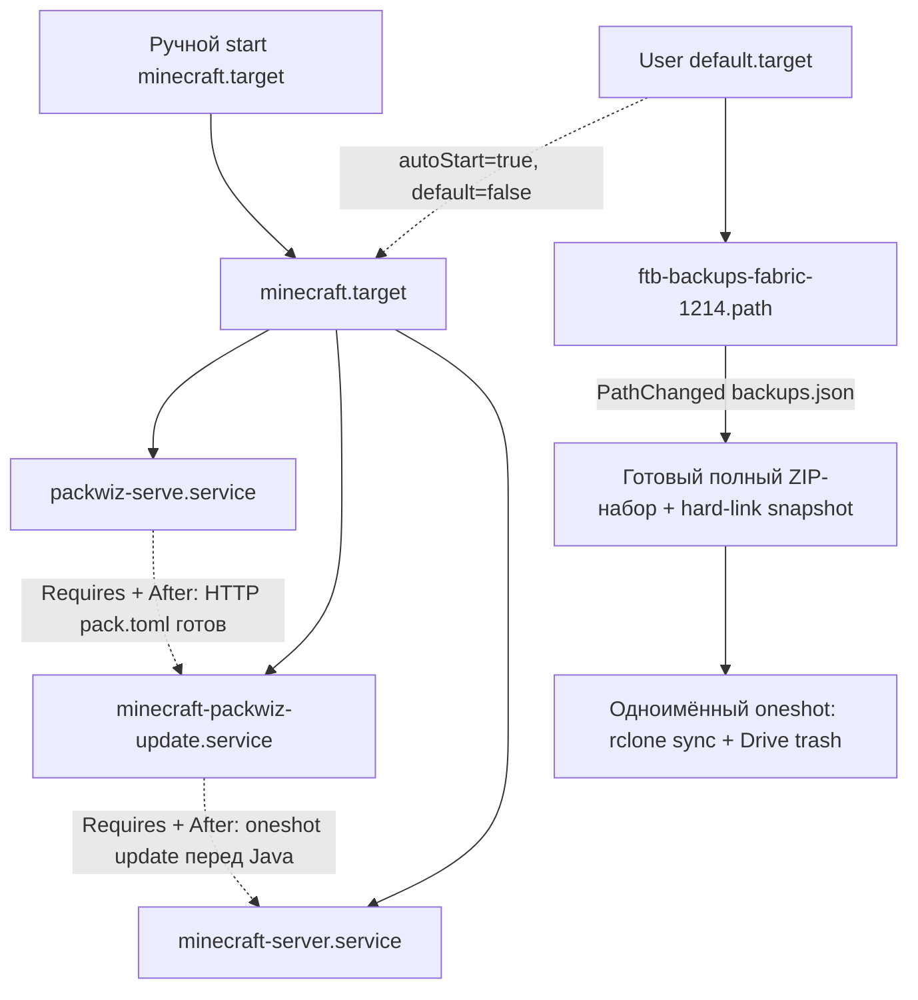
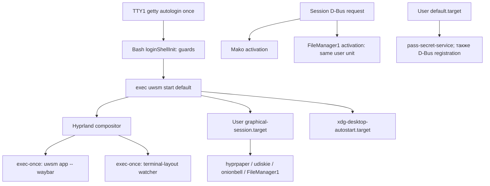

# Карта запуска: Minecraft, proxy и GUI

[Каталог](README.md) · [Решения и вопросы](feedback.md)

Source-first срез **08.11.2026**, конфигурация `086d82e`. Это описание объявленного
поведения, не доказательство работающих процессов. При исходном срезе службы,
конфиги и ручное состояние не менялись; последующая backup-правка описана ниже.
Область: выбранные цепочки Acer; не полный startup/security audit.

## Как читать зависимости

- `WantedBy` задаёт подключение при enable/декларативной установке; не запускает
  произвольный target само по себе. `After` задаёт порядок, не готовность HTTP/сети.
- `Requires` подтягивает зависимость; `PartOf` распространяет stop/restart от
  указанной unit к зависимой. Это разные связи.
- User `default.target` относится к запуску пользовательского systemd manager,
  не обязательно к появлению GUI. Состояние lingering/ручных enable не обследовалось.

Семантика: [systemd.unit(5)](https://www.freedesktop.org/software/systemd/man/latest/systemd.unit.html).

## Minecraft: отдельный запуск и независимый backup watcher

Источники: [flake](../../flake.nix#L252-L297),
[instance](../../home/apps/minecraft/default.nix#L9-L12),
[generic module](../../home/modules/minecraft/server/default.nix),
[его инструкция](../../home/modules/minecraft/server/README.md).

На Acer/desktop подключены instance и generic module; на VPS HM — только generic,
где `minecraft.server = null` по умолчанию. Один import не включает VPS Minecraft.



| Элемент            | Что объявлено                                                    | Следствие                                                                                           |
| ------------------ | ---------------------------------------------------------------- | --------------------------------------------------------------------------------------------------- |
| `minecraft.target` | Ручной по умолчанию, `autoStart=false`; три службы PartOf target | Stop/restart распространяется на стек; opt-in привязывает к user default, не обязательно GUI login  |
| Packwiz serve      | HTTP 8180, ExecStartPost curl readiness, start timeout 40s       | Update ждёт HTTP pack.toml; запросы обходят proxy, ошибку повторяют примерно до 30s                 |
| Update             | `Type=oneshot`, RemainAfterExit, Requires/After serve            | После успеха active (exited); restart target повторяет update перед Java                            |
| Fabric             | Requires/After update, `Restart=always`, `-Xmx20G`               | Heap cap, не лимит всей памяти процесса. Автоматический рестарт не равен повторной активации update |
| Backup watcher     | Теперь `PathChanged` manifest, WantedBy user default             | Может работать без Minecraft; helper проверяет завершённость, watcher не является retry timer       |
| Backup upload      | Guard + hard-link snapshot → `rclone sync`, oneshot              | Полное зеркало допущенного набора, явная Drive trash; авторизация/сеть остаются внешними            |

### Исходные находки и последующие статусы

| ID / важность                                       | Факт и уверенность                                                                                                | Последствие / следующий шаг                                                                                                                                                                           |
| --------------------------------------------------- | ----------------------------------------------------------------------------------------------------------------- | ----------------------------------------------------------------------------------------------------------------------------------------------------------------------------------------------------- |
| START-01 / до повседневного использования Minecraft | Подтверждено исходниками: services не имеют `PartOf=minecraft.target`; target не задаёт stop propagation          | Stop/restart target не гарантирует stop/restart его процессов. Проверить желаемый lifecycle, затем отдельная правка generic module и тест без настоящего мира                                         |
| START-02 / до повседневного использования Minecraft | README предлагает `enable minecraft.target`, но у target нет install-связи; подтверждено исходниками              | Одна команда enable не создаёт нужный autostart. Сначала выбрать ручной или login start; исправить инструкцию/модуль вместе                                                                           |
| START-03 / до повседневного использования Minecraft | В коде нет HTTP readiness у serve; runtime-гонка — гипотеза                                                       | `After` простого процесса не доказывает доступность pack.toml. Проверить cold start без внешних данных, затем выбрать readiness/retry при необходимости                                               |
| START-04 / до доверия backup                        | `PathModified` + `rclone sync`, нет признака «архив готов»; подтверждено исходниками, реальная гонка не проверена | sync может удалять лишние файлы назначения и реагировать до завершения записи. Уточнить retention, атомарность архивов, retry и нужна ли именно зеркальная копия; проверять на disposable destination |

`rclone sync` не выполнялся. Ни мир, ни backup remote, ни credentials не читались.
START-04 получил отдельную согласованную реализацию ниже; интеграция ещё не проверена.
START-01..03 получили lifecycle/opt-in/HTTP-readiness правку ниже; настоящий
Minecraft runtime не испытывался. Строки таблицы выше сохраняют исходные находки.

**Последующее решение пользователя:** пока ручной запуск Minecraft, но с простой
отдельной опцией включения автозапуска при необходимости (по умолчанию выключена).
Позже lifecycle и эта опция реализованы ниже. По backup пользователь попросил
пояснение: при локальном удалении архива `sync` удаляет и соответствующий облачный
файл. Загрузка без удаления облачных копий потребует отдельной политики хранения;
вариант не был выбран на том шаге, код backup тогда не менялся.

### Read-only проверка доступности реальных backup

После обсуждения зеркала с guard пустого источника и штатной Drive trash пользователь
разрешил проверить размер/частоту архивов, ротацию и свободную облачную квоту.
Результат на Acer **08.11.2026**:

- Каталог сервера из instance module отсутствует; в проверенном Minecraft project
  directory есть Packwiz, но нет указанного server directory. Это не доказывает
  отсутствие мира/архивов на другой машине или по другому пути.
- Текущий CLI `rclone v1.74.3` сообщает об отсутствующем config-файле;
  `listremotes --long` не содержит ожидаемый `gd-backups`. Из вывода selected
  `config redacted` проверялись только поля type/use_trash; содержимое авторизации,
  остальные remotes и raw diagnostics в отчёт не выводились. Успешный exit этой
  команды сам по себе не доказывает наличие remote.
- Read-only `systemctl --user show` для backup path/service подтвердил
  `loaded/active/waiting` и `loaded/inactive/dead` соответственно. Это состояние
  unit, не тест доставки; окружение systemd service отдельно не обследовалось.
- Размеры/частота архивов, фактическая ротация и backend/use_trash/облачная квота
  **не установлены**. `rclone about`, listing облачных файлов, sync/copy/delete,
  восстановление и запуск Minecraft не выполнялись. Службы не изменялись.

Уточнение к прежнему риску удаления: [rclone drive](https://rclone.org/drive/#drive-use-trash)
по умолчанию отправляет удаляемые файлы в корзину (`use_trash=true`).
[Google Drive](https://support.google.com/drive/answer/2375102) хранит их там 30 дней;
они продолжают занимать квоту. Это документированный контракт backend, не проверка
текущего remote. Кандидат без собственного cleanup: mirror + empty/missing-source
guard + explicit trash, только готовые архивы. Проверить месячный объём удалений
до выбора этой схемы: короткий локальный retention не ограничивает квоту trash
тем же числом архивов. Восстановление тестировать отдельно на изолированных данных.

Следующий запрос был о фактическом расположении сервера; пользователь затем уточнил,
что сервер **нигде не запущен**, и предоставил внешний server repo (ниже).
Не создавать пустой источник, credentials или новый remote на Acer только ради
прохождения проверки; не подключаться к другой машине без отдельного разрешения.
Для этого документального результата activation не нужна.

### Внешний server repo: ротация пяти архивов

Пользователь подтвердил синхронизацию всего набора и отсутствие сейчас работающего
сервера. Через read-only GitHub HTTP, без Git fetch/clone, проверен
[config/ftbbackups2.json](https://github.com/tea06194/minecraft_server_fabric_1.21.4/blob/db747b1ca56fa8d9877114df4ca3fe545dcbdc8a/config/ftbbackups2.json).
Последний modifying commit этого файла — `db747b1`, 23.08.2025; на момент чтения
файл в `main` содержал:

```json
{
  "enabled": true,
  "retention_mode": "MAX_BACKUPS",
  "max_backups": 5,
  "backup_cron": "0 */30 * * * ?",
  "only_if_players_been_online": true,
  "backup_location": ".",
  "backup_format": "ZIP"
}
```

Это выбранные поля, не полный config. Cron — каждые 30 минут; условие игрока
ограничивает backup при простое. `keep_latest/hourly/daily/weekly/monthly` относятся
к невыбранному `TIERED`, а не добавляются к пяти в `MAX_BACKUPS`. Локальный Packwiz
manifest указывает FTB Backups 2 `1.0.29` для Fabric 1.21.4; запуск binary и фактическая
ротация здесь не проверялись.

- Пользователь ожидает зеркало всего локального набора. Предложение агента отправлять
  один архив за день игры **не принято**, частоту uploads этим аудитом не менять.
- После локальной ротации и успешного `rclone sync` облачная папка повторяет source:
  при пяти локальных ZIP лишние cloud-only архивы удаляются из этой папки; другие
  локальные файлы вроде `backups.json` тоже участвуют. Но сначала source нужно
  осознанно восстановить/инициализировать: sync не скачивает старый мир из облака.
- Пользовательский screenshot показывает 10 ZIP общим отображаемым размером около
  5,1 GB и занятость аккаунта 6,39 из 15 GB; это визуальные данные пользователя,
  не API-проверка текущей квоты и не подтверждение содержимого локальной папки.
  Причину расхождения десяти облачных копий с config=5 без истории sync не определяли.
- Предел пяти **видимых** архивов не ограничивает объём Drive trash: удалённые ZIP
  ещё занимают квоту до 30 дней. При активной игре и новых ZIP порядка 500 MB каждые
  полчаса оборот может быть около 1 GB/час; это условная оценка, не измерение трафика.
- Guard должен проверять наличие **готовых архивов**, не просто непустую директорию:
  один `backups.json` не должен разрешать массовое удаление облачных ZIP. Сам факт
  наличия архива ещё не доказывает завершение записи — readiness требует отдельного
  контракта с backup-модом. Нельзя считать guard полноценной защитой от частичного
  случайного удаления.

На этом документальном шаге код служб/backup не менялся. Нужна была реализация lifecycle/guard/readiness
и решение о допустимом расходе trash; постоянное удаление и очистка общей корзины
не разрешены. Не подменять ожидаемую локальную ротацию собственной облачной политикой
без согласия пользователя.

### Реализованный guard и readiness: только fixture-проверки

После пользовательского «го» добавлен
[backup-sync.py](../../home/modules/minecraft/server/backup-sync.py) и
[26 локальных тестов](../../home/modules/minecraft/server/test_backup_sync.py).
Контракт подтверждён исходниками FTB Backups 2 **1.0.29**:
[BackupHandler.java](https://github.com/FTBTeam/FTB-Backups-2/blob/0f9c4ff652c57c2f8d3e6b5c78687f8c48623800/common/src/main/java/net/creeperhost/ftbbackups/BackupHandler.java#L224-L227)
пишет incomplete до архивации, после неё задаёт SHA‑1/размер/complete
([L355–372](https://github.com/FTBTeam/FTB-Backups-2/blob/0f9c4ff652c57c2f8d3e6b5c78687f8c48623800/common/src/main/java/net/creeperhost/ftbbackups/BackupHandler.java#L355-L372)).
JSON переписывается неатомарно; закрытие manifest — повод проверить, не гарантия успеха.
Старые записи без complete принимаются по upstream default=true.

- Требуется непустой полный набор завершённых ZIP и manifest, точное совпадение
  размеров/имён, regular files, непустой ZIP central directory. Любое расхождение
  блокирует весь sync. Incomplete/обнаруженная гонка откладывают его.
- Watcher заменён на `PathChanged` manifest. Hard-link snapshot в приватном
  marked sibling cache удерживает архивы при локальной ротации, не копируя их байты.
  Копируется только manifest. Нужны hard links на одной файловой системе; после
  crash место может удерживаться до следующего запуска/очистки managed snapshot.
- Весь допущенный набор зеркалируется в прежнее назначение с прежним bandwidth;
  добавлены check-first/delete-after и explicit Drive trash. Нет собственного
  ограничения «пять», permanent deletion, очистки корзины или редких uploads.
- 26 unittest fixtures прошли: guards, ZIP/metadata/layout, ссылки, гонки подготовки,
  ротация во время fake upload, cache recovery/ownership, lock, файловый отказ,
  ошибка fake rclone, сохранение lock осиротевшим fake transfer. Узкая offline module evaluation с fixture packages прошла:
  inactive=null, watcher, wrapper/dependencies/escaping, прежний ручной target.
  Это не полная HM evaluation и не тест настоящего rclone/systemd.
- Nix отформатирован nixfmt 1.3.1. Ruff CLI отсутствует; Python не форматировался
  заменяющим инструментом. Полный SHA‑1/CRC, запуск Minecraft, реальная ротация,
  Drive sync/deletion/quota/restore, builds и activation **не выполнялись**.

Ограничения: архивы после complete считаются неизменяемыми по FTB-контракту;
hard links не защищают от записи в тот же inode. Guard не распознает корректный,
но ошибочно уменьшенный/чужой backup-набор. Persistent incomplete блокирует upload;
retry timer не добавлен. Drive trash quota остаётся открытым эксплуатационным вопросом.
Lifecycle/Packwiz HTTP readiness выполнены следующим отдельным шагом ниже.
Применение только через HM laptop/desktop; порядок и журнал — в
[инструкции модуля](../../home/modules/minecraft/server/README.md#проверка-и-применение).
VPS generic import с null не создаёт units; NixOS rebuild для этой правки не нужен.

### Lifecycle, ручной default и HTTP readiness

Пользователь сообщил об успешном `home-manager switch --flake ~/nix-config/.#samov-laptop`
после `05ed0d7`. Это подтверждает пользовательскую сборку/activation предыдущего
шага на Acer, не текущего lifecycle diff и не фактический upload/restore.
На сомнение, стоило ли заниматься Minecraft на Acer, пользователь отдельно уточнил:
**не прекращать начатую донастройку и фиксы**. Продолжаем согласованные исправления,
но не запускаем здесь настоящий Minecraft ради проверки.

- `PartOf=minecraft.target` у serve/update/Java распространяет stop/restart.
  Backup watcher/service остаются независимыми. Update `RemainAfterExit=true`
  сохраняет завершённый oneshot активным до stop/restart, не держит процесс Java.
- `minecraft.server.autoStart` — bool default=false. Только true добавляет target
  в user default.target; null по-прежнему не создаёт units. Ручной сценарий сохранён.
- Serve использует Type=exec и ExecStartPost curl к тому же loopback URL, что
  installer. Query timeout 1s, retry window примерно 30s, unit start timeout 40s;
  proxy обходится явно, `.curlrc` игнорируется. Restart=always сохранён, задержка повторного старта serve 5s.
  `After` учитывает ExecStartPost по
  [systemd.service(5)](https://www.freedesktop.org/software/systemd/man/latest/systemd.service.html#ExecStartPre=).
- Reusable [module fixtures](../../home/modules/minecraft/server/test_module.nix)
  проверяют null/manual/opt-in, PartOf/order/Requires/RemainAfterExit/readiness
  и прежнюю независимость backup. [Lifecycle tests](../../home/modules/minecraft/server/test_lifecycle.py)
  прошли: fixture unit graph через systemd-analyze verify и настоящая curl-команда
  на loopback HTTP: 200 без proxy/влияния `.curlrc`, 503→200 retry и ограниченный отказ 404 с production
  retry-параметрами (4 теста). Все 26 backup-тестов также повторно прошли. Это лёгкие
  локальные проверки без сборок и запуска user services.

Ограничения: статическая проверка graph не является runtime stop/restart; не проверены
реальный Packwiz cold start, installer/mods, Java shutdown/save, клиент, autostart
при входе или full HM build нового diff. Target active не гарантирует здоровье
Wanted services. Падение только serve не автоматически восстанавливает весь стек;
после исправления причины — restart target. Heap `20G` и выбор машины не менялись.
Реальные cloud/quota/restore по-прежнему вне выполненных проверок. Ruff недоступен.
Применение — только HM laptop/desktop; NixOS rebuild не нужен. Безопасные fixtures
и отложенная ручная проверка на машине с реальным сервером описаны в README модуля.

**Последующее подтверждение пользователя:** HM switch после `af081be` на Acer
успешен; следовательно, пользовательская сборка/activation этого diff выполнены.
Отдельный `nix build` перед switch не обязателен: он отделяет сборку от активации,
но switch тоже сначала собирает конфигурацию. Live Minecraft/Drive этим не проверены.
Пользователь также подтвердил, что исходный сервер/backups/Packwiz updates работали
на Arch, затем на NixOS. Находки аудита не означают, что прежний сценарий был сломан.

Узкое read-only сравнение с `25de455` не выявило дополнительной явной ошибки, но
совместимость с настоящим набором backups не подтверждена. Намеренные отличия:
строгий guard может отклонить каталог с посторонними файлами, links или incomplete
entry; HTTP readiness ограничена по времени; после успешного update его повторный
запуск выполняется через restart всего target, а не обычный рестарт Java. Политика
локальной ротации FTB, полный mirror, remote/bandwidth, server/bootstrap JAR и heap
не менялись. Перед доверием новому runtime нужны реальные проверки из README,
не автоматический запуск мира на Acer. Это дополнение только к документации,
новая activation для него не требуется.

**Где продолжить живые проверки:** пользователь выбрал запуск Minecraft только на
новом ПК. Незавершённые runtime/restore проверки и остальные Lenovo-only пункты
собраны в [коротком checklist](lenovo-checklist.md); не переносить их обратно в
план запуска Minecraft на Acer. Остальные согласованные fixes и аудит продолжаются.

## Proxy: основной Amnezia и резервный v2rayA

Источники: [host](../../hosts/laptop/default.nix#L64-L95),
[Linux HM packages](../../home/linux/core-set/default.nix),
[Fish](../../home/core-set/shell.nix),
[локальный Amnezia package](../../pkgs/amnezia-vpn/default.nix#L148-L175).

| Компонент           | Кто запускает                                                                                                                                   | Что это не доказывает                                                                                                                   |
| ------------------- | ----------------------------------------------------------------------------------------------------------------------------------------------- | --------------------------------------------------------------------------------------------------------------------------------------- |
| v2rayA              | Pinned NixOS module: system `v2raya.service`, WantedBy multi-user, root, `Restart=on-failure`; After network/nss/firewall targets               | `network.target` не гарантирует интернет. Profiles, активный tunnel и routing зависят от runtime state                                  |
| Xray для v2rayA     | `cliPackage = pkgs.xray` подменяет backend в package v2rayA                                                                                     | HM `xray` не нужен для этой зависимости                                                                                                 |
| Xray внутри Amnezia | Локальный пакет линкует собственную `amnezia-xray-bindings` 1.3.0 как статическую библиотеку                                                    | Не тот же экземпляр CLI из HM; наличие Xray-кода не означает активный Xray tunnel                                                       |
| Amnezia             | NixOS module регистрирует package units/D-Bus, Wants через multi-user для `AmneziaVPN.service`, включает resolved; host добавляет iptables/gawk | Старт daemon не равен GUI/autoconnect. Package умеет генерировать GUI autostart, но текущие пользовательские настройки не обследовались |

**START-05 / до изменения proxy, подтверждено исходниками:** v2rayA и Amnezia
подключены одновременно как системные службы. Возможный конфликт DNS/routes —
гипотеза, не факт двух активных туннелей. Пользователь уточнил: Amnezia — основной
клиент, v2rayA — резерв для проверки/обновления ключа и подключения при необходимости.
Смена клиента на Throne остаётся отдельным возможным шагом, не принятым решением.

### Продолжение proxy-аудита: удаление неиспользуемого CLI и helper

В пределах Nix/source declarations разделены три роли Xray:

- v2rayA получает `pkgs.xray` через `cliPackage`; его backend не зависит от наличия
  `xray` в пользовательском PATH. Настройка существовала до выделения laptop
  (`f7de937`, исходная desktop-конфигурация — `6399ae7`).
- Прямой HM CLI добавлен отдельно коммитом `232684e` (`add xray`). Пользователь
  подтвердил, что не запускает его вручную, и разрешил убрать: удалён только `xray`
  из Linux HM package list laptop/desktop. Backend v2rayA остаётся в NixOS;
  удаление HM entry не обещает освобождения его store closure.
- Amnezia использует собственную
  [статическую библиотеку](../../pkgs/amnezia-vpn/xray-lib.nix) и явную
  [линковку](../../pkgs/amnezia-vpn/default.nix#L160-L165), не HM CLI. Pin/patches
  AWG и backend в этом проходе не менялись. Два daemon не доказывают два активных VPN.

**PROXY-01 / устранён удалением неиспользуемой функции:** исходный `vpn` мог менять
уже существующий global `all_proxy`. После локального воспроизведения пользователь
уточнил, что helper не использует: переменные задаёт напрямую в нужных сессиях.
По его разрешению удалены функция и ставший ненужным `test_vpn.py`; промежуточный
scope-fix не сохраняется как отдельное изменение. Ручные переменные не менялись.

**Стоимость резервного сервиса, Acer, 08.11.2026:** whole-unit snapshot v2rayA
вместе с дочерним Xray — **26.01 MiB RAM**, CPU за **5 секунд — 0.0% одного ядра**.
Исторический peak с запуска — **167.84 MiB**, не текущий idle расход. Это короткое
наблюдение, не долгосрочный benchmark и не проверка отсутствия активного tunnel.
Рекомендация — сохранить сервис для быстрого резервного подключения; остановка или
отключение autostart не согласованы и не выполнялись. Ключи, профили и routes не читались.

**Будущие Throne / NaiveProxy:** в текущем pinned nixpkgs пакет Throne 1.0.13
поставляет собственный `Core`, собранный на sing-box, без зависимости от отдельного
HM `xray`. По [текущему upstream](https://throneproj.github.io/get_started/) новые
версии используют также Xray для части профилей; перед переходом проверить именно
выбранный пакет/протокол и NixOS TUN integration, а не сохранять ненужный CLI заранее.
NaiveProxy не требует Xray: [сервер здесь](../../hosts/server/proxy.nix) — Caddy с
forwardproxy, клиенту нужен Naive-совместимый backend. Это не live-тест соединения
и не обещание поддержки Naive старым pinned Throne.

Применение — только HM, не NixOS rebuild: на Acer
`home-manager switch --flake .#samov-laptop`, затем новый терминал/Fish shell;
уже загруженная функция в старом shell может сохраниться. Удаление helper общее для
laptop/desktop/server/mac HM; CLI удалён из Linux workstation module laptop/desktop.
Остальные профили получают изменения при своей HM activation (server — на VPS по SSH,
Mac — на самом Mac). Документация activation не требует. Пользователь затем подтвердил
успешный Acer HM switch после `e2e8cd0`; сборка/activation этого proxy diff подтверждены
им, live proxy/DNS/routes и остальные машины не проверялись. Агент службы и подключения
не менял.
Узкая offline evaluation старых/новых модулей с fixture packages подтвердила:
удалены только Fish helper и HM `xray`; остальные shell-настройки для stateVersion
25.11/26.05, Linux packages и phone aliases сохранены. Это не полный HM build.

## Android/MTP и съёмные диски: разные протоколы, без лишнего меню

Источники: [Linux CLI](../../home/linux/core-set/default.nix),
[udiskie](../../home/linux/gui-set/default.nix#L38-L43),
[активный Tofi](../../home/linux/modules/tofi/default.nix),
[архив mount-menu](../../home/linux/modules/archive/tofi-mountmenu.nix).

- `adbfs-rootless` и `android-tools` с aliases добавлены вместе в `71f3a36`.
  Пакет adbfs вызывает `adb` по явному store path; «rootless» означает отсутствие
  требования root на телефоне, не отсутствие USB debugging/ADB authorization.
  Это другой протокол, не MTP. [Контракт upstream](https://github.com/spion/adbfs-rootless/blob/fd56381af4dc9ae2f09b904c295686871a46ed0f/README.md).
- В `27a0407` пользователь первоначально выбрал ADB: `android-tools` был оставлен.
  По согласию тогда удалены только adbfs и `phone-mount`/`phone-unmount` из shared Linux
  workstation module laptop/desktop. Системные группы/udev rules не менялись;
  пригодность нынешних USB permissions для конкретного телефона этим не проверена.
- Для MTP выбран прежний on-demand `jmtpfs` через `nix shell`, без постоянного
  пакета/aliases/GVfs. Он даёт обычный каталог для Yazi; на телефоне выбрать
  «Передача файлов» и разрешить доступ, USB debugging для MTP не нужен.
  В pinned package используется FUSE 2, upstream unmount — `fusermount -u`,
  а не слепое сохранение прежнего alias с `fusermount3`.
- **Последующее уточнение:** пользователь вспомнил, что ADB stack добавлялся ради
  удобного переноса файлов, и разрешил убрать также `android-tools`. Он удалён
  из HM laptop/desktop; NixOS группы и USB rules не менялись. Пользователь хочет
  автоматический доступ к телефону и отображение в udiskie. MTP не требует USB
  debugging, но требует разблокировки/выбора передачи файлов и разрешений телефона.
  [Udiskie](https://github.com/coldfix/udiskie) — frontend UDisks2, не MTP UI;
  установка ADB/GVfs сама по себе не добавляет телефон в его tray menu.
  Готовая база интеграции — GVfs/MTP с FUSE-представлением в
  `$XDG_RUNTIME_DIR/gvfs/` для Yazi, но обнаружение телефона не равно mount.
  Автоматическое монтирование в Hyprland и нужный UI ещё требуют выбора;
  GVfs/новые службы/GUI не включены, jmtpfs остаётся ручным запасным вариантом.
  [Границы MTP и интеграция](https://wiki.archlinux.org/title/Media_Transfer_Protocol#File_manager_integration).
- MTP не полноценный POSIX-диск. В [jmtpfs 0.5](https://github.com/JasonFerrara/jmtpfs/blob/v0.5/README)
  редактирование/rename может требовать полного копирования файла туда-обратно.
  Предпочтителен перенос готовых файлов, а не работа с проектом прямо на телефоне;
  этот аудит не измерял скорость и не проверял реальный transfer.
- UDisks2 + udiskie управляют дисками, не MTP. В pinned HM defaults udiskie:
  automount=true, notify=true, tray=auto; конфиг уже задаёт nested menu, Waybar
  tray включён на обоих ПК. Это source contract, не проверка живого значка.
- Tofi mount-menu — только ручной `lsblk` → `udisksctl mount/unmount`, не второй
  daemon и не MTP browser; отдельных hotkeys laptop/desktop для него нет.
  Пользователь разрешил убрать дублирующий интерфейс и перенести реализацию в
  `home/linux/modules/archive/` рядом с `tofi/`. Архивный модуль не импортируется;
  для возврата нужны явный import и `programs.tofi.mountmenu.enable = true`.
  Исходный скрипт сохранён, не считается исправленным или проверенным на реальных дисках.
  Tofi launcher/passmenu/sessionmenu/F1-help и udiskie не менялись.

Ручной MTP workflow при необходимости (не выполнялся агентом):

```fish
nix shell nixpkgs#jmtpfs
mkdir -p ~/mnt/phone
jmtpfs ~/mnt/phone
# Открыть ~/mnt/phone в Yazi; после завершения операций и выхода из каталога:
fusermount -u ~/mnt/phone
exit
```

`nix shell nixpkgs#...` использует пользовательский registry, не гарантированно
версию из flake.lock этого репозитория. `fusermount` берётся из штатного NixOS
FUSE setup (по умолчанию включён, с security wrappers), не из нового sudo workaround.
Не запускать одновременно несколько MTP
клиентов к одному телефону. Не выполнять mount от root ради обхода ошибки доступа:
сначала проверить USB mode/udev permissions. Проверки Lenovo добавлены в существующий
[общий workflow-пункт](lenovo-checklist.md), не в отдельный конкурирующий список.

Применение этого cleanup — HM laptop/desktop (`home-manager switch --flake
.#samov-laptop` или `.#samov-desktop`), затем новое Fish shell: старые aliases могут
оставаться загруженными. NixOS rebuild не нужен; server/mac эти модули не импортируют.
Документация и архив не требуют отдельной activation. Телефон/диски не монтировались,
ADB server не запускался; реальный MTP/udiskie остаётся ручной проверкой.
Изолированная offline evaluation настоящих старых/новых Nix-модулей с fixture
packages/option sinks подтвердила: удалены только adbfs и его aliases; остальные
Tofi settings и тела скриптов неизменны. В active module нет mountmenu option;
архивный import без enable ничего не устанавливает, явный opt-in восстанавливает
исходный package list и скрипт, выключенный Tofi не устанавливает меню даже с opt-in.
Это не полная HM evaluation/build и не проверка реальных mounts.
Последующее удаление `android-tools` проверено отдельной offline evaluation
старого/нового Linux core-set с fixture packages: остался только прежний `btop`.

## Python/Node: глобальные CLI и явные prerequisites Mason

Пользователь сохраняет Python/Node для разовых скриптов и тестовых серверов.
Mason остаётся единым менеджером LSP/линтеров/форматтеров, Neovim config — внешним.
[Opt-in модуль](../../home/core-set/devtools/neovim-mason.nix) явно импортирует базовый
Neovim и существующие [Node](../../home/core-set/node.nix)/[Python](../../home/core-set/python.nix)
modules. В `flake.nix` он заменяет прежние отдельные Node/Python imports только
на laptop/desktop/mac; server остаётся на базовом Neovim без этих глобальных CLI.
Повторный import базового Neovim дедуплицируется Nix module system по пути файла.

Это группировка зависимостей профиля, **не** отдельное герметичное окружение Neovim:
CLI остаются в общем PATH. Используются те же `pkgs.nodejs`/`pkgs.python3`, не вторые
версии или копии. Nix уже переиспользует одинаковые store paths; само наличие пакета
в PATH не запускает daemon и не потребляет CPU/RAM процесса.

Версии/lock не менялись. Node LTS policy сохраняется для отдельного обновления
inputs; этот шаг не подтверждает, что нынешний снимок содержит самую свежую LTS.
У Python нет отдельной LTS-ветки; выбирать поддерживаемую совместимую версию.
Mason PyPI tools создают venv с внешним интерпретатором: при смене Nix Python и GC
старые ссылки могут требовать пересоздания окружений. Ни глобальный CLI, ни новый
import module сами эту проблему не устраняют. Не копировать Mason venv на Lenovo
как гарантированно переносимый runtime; новую установку проверить отдельно.

Go, direnv и внешние Neovim/Lazy/Mason files не менялись. Direnv project-switching
сохранён в agent-todo, не реализуется сейчас. Применение структуры — HM нужного
профиля (Acer: `home-manager switch --flake .#samov-laptop`); server без изменений,
NixOS rebuild не нужен. Документация activation не требует. Сборка/activation нового
diff и реальные Mason/LSP на Lenovo этим не проверены.
Узкие offline checks сравнивают фактические module lists из flake через HM stub и
старые/новые Neovim runtime modules через pinned `lib.evalModules` с fixture packages:
состав трёх workstation/mac профилей сохранён, server list неизменен, базовый Neovim
дедуплицирован, те же три package references и editor/aliases settings сохранены.
Это не полная HM evaluation/build или runtime-проверка Mason.

## GUI: UWSM владеет сессией, не второй HM compositor service



Источники: [system login/UWSM](../../hosts/laptop/default.nix#L166-L203),
[HM Hyprland](../../home/linux/modules/hyprland/default.nix#L89-L141),
[raw autostart](../../home/linux/laptop/hyprland.conf#L34-L51),
[GUI imports/services](../../home/linux/gui-set/default.nix),
[FileManager1](../../home/linux/modules/filemanager1-common/default.nix#L109-L139),
[Waybar](../../home/linux/modules/waybar/default.nix#L1-L5).

- Guards: VT1, нет DISPLAY/WAYLAND_DISPLAY, `uwsm check may-start`. Это Bash login,
  а не Fish interactive init. Autologin — существующая policy Acer, не принятое
  решение безопасности Lenovo; login shell/runtime route здесь не испытывался.
- `programs.hyprland.withUWSM=true`; HM compositor `systemd.enable=false`,
  `package=null`, `portalPackage=null`: не создаёт конкурирующий HM compositor start,
  binary/portal поставляет NixOS. UWSM импортирует HM session variables через
  управляемый `uwsm/env`; также подключается существующий theme env fragment.
- Waybar стартует через `exec-once`/`uwsm app`; HM `programs.waybar.enable` сам по
  себе не включает `systemd.enable` (default false). В выбранной цепочке второго
  декларативного Waybar autostart нет; ручные `.config/autostart` не проверялись.
- Hyprpaper и udiskie — HM services graphical target. Onionbell — local user unit
  WantedBy/PartOf graphical, condition на Hyprland environment, After audio units.
  `After` audio units не равен readiness звукового устройства; live bell не проверялся.
- FileManager1 одновременно WantedBy graphical и D-Bus-activated через **ту же**
  user unit (`Type=dbus`). Это не два daemon. Wrapper по текущему local default —
  **Kitty + Yazi**, не Alacritty; MIME associations отдельно выбирают приложения,
  а не постоянно запускают их ([XDG](../../home/linux/gui-set/xdg.nix#L42-L66)).
- Mako: pinned HM регистрирует package D-Bus services, не local `exec-once`.
  Последующая selected evaluation трёх GUI-профилей подтвердила registration;
  отсутствие local HM unit не означает отсутствие package D-Bus activation.
  Default timeout 60 секунд не отменяет timeout отправителя; штатная история
  5 уведомлений не отключена, содержимое не читалось. Цвета не привязаны к F11.
  [Границы проверки](feedback.md#уведомления-mako-ограниченная-проверка).
  Pass-secret-service: HM user service WantedBy/PartOf default и D-Bus registration;
  наличие регистрации не означает чтения/разблокировки password store в этом аудите.
- Gpg-agent: pinned HM задаёт socket activation (`sockets.target`), не отдельный
  Hyprland autostart. Общая policy ограничивает кеш часом и запрещает внешний
  pinentry cache; Linux GUI использует pinentry-qt. Выбранные merged HM-атрибуты
  Acer подтверждают SSH support=false и отсутствие GNOME Keyring, но runtime
  сокетов/кеша/расшифровки не проверялся. Tofi passmenu запускается вручную через
  `Super+Shift+P`; по решению пользователя вводит первую строку **без Enter**.
  Проверки и применение — в [журнале](feedback.md#gpgpass-и-ввод-пароля-через-tofi).
- Terminal-layout watcher подписывается на Hyprland socket и переключает раскладку
  при фокусе терминала; [script](../../home/linux/modules/hyprland/scripts/terminal-layout-en.sh)
  использует `socat` из [core packages](../../home/core-set/packages.nix).

## Upstream provenance и границы покрытия

Проверены локальные исходники выше и **pinned** upstream modules, а не документация
неизвестной новой версии:

- [nixpkgs 0ad6f47: v2rayA](https://github.com/NixOS/nixpkgs/blob/0ad6f47ea4fe188f4bc8f0380f93ae8523337c6c/nixos/modules/services/networking/v2raya.nix),
  [Amnezia](https://github.com/NixOS/nixpkgs/blob/0ad6f47ea4fe188f4bc8f0380f93ae8523337c6c/nixos/modules/programs/amnezia-vpn.nix),
  [Hyprland/UWSM integration](https://github.com/NixOS/nixpkgs/blob/0ad6f47ea4fe188f4bc8f0380f93ae8523337c6c/nixos/modules/programs/wayland/hyprland.nix)
  и [UWSM](https://github.com/NixOS/nixpkgs/blob/0ad6f47ea4fe188f4bc8f0380f93ae8523337c6c/nixos/modules/programs/wayland/uwsm.nix).
- [HM af2beae: services](https://github.com/nix-community/home-manager/tree/af2beae5f0fae0a4310cc0e6aef2572f56090353/modules/services):
  `hyprpaper.nix:84–103`, `udiskie.nix:127–140`, `mako.nix:149–165`,
  `pass-secret-service.nix:52–75`; также `modules/wayland.nix:10`,
  `modules/dbus.nix:13–35`, `modules/programs/waybar.nix:222–244,346–367`.

Остались: прочие user/system units и sockets, xremap external module, portals/audio,
XDG autostart desktop files, реальные login/environment/order, ручной enable/lingering,
активные поколения, сетевые профили и приложения. Ни полного effective-host
evaluation/build, ни старта/остановки, ни boot-time измерений в этом шаге нет.

Выполнены форматирование Prettier 3.9.5, проверка локальных ссылок/границ строк,
whitespace и узких sensitive-patterns. Изолированная evaluation настоящего
Minecraft module подтвердила inactive default, target/service hooks, Requires chain,
отсутствие PartOf, heap flag и независимый watcher. Package paths заменены fixture
строками, systemd options приняты в attribute sink: это проверка деклараций,
не полноценная HM evaluation, unit lifecycle или backup integration test.

**Применение:** документация, NixOS/HM switch не требуется. Для следующего малого
шага сначала решить lifecycle/autostart Minecraft и смысл backup, затем отдельно
править generic module/README и проверять на изолированных данных. Рабочий сервер
или настоящий backup remote для эксперимента не использовать.
